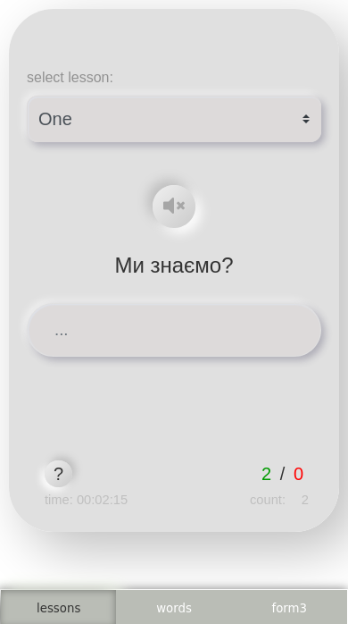
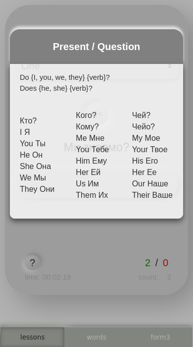
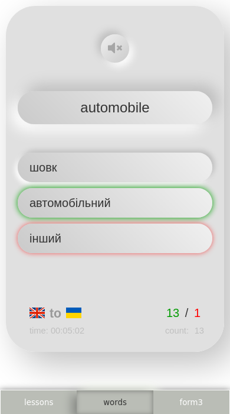
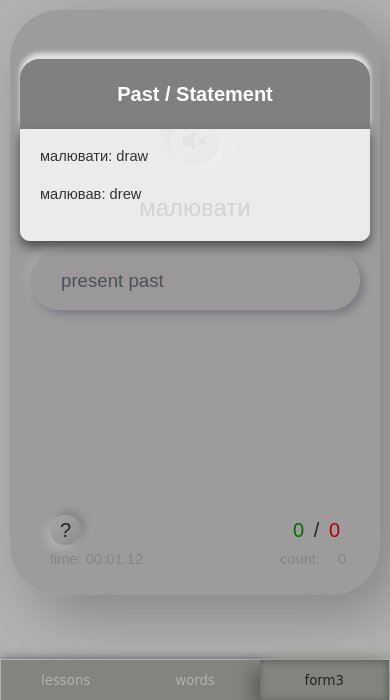

# Learn English

A lightweight browser-based application for practicing English vocabulary, sentences, grammar, and verb forms.

The application was originally created as a personal learning tool. The product idea, learning workflows, UI, and frontend architecture were designed and implemented independently from scratch rather than being based on a tutorial or predefined specification.

The project is built with vanilla JavaScript and uses browser APIs for local progress persistence and English pronunciation.

## Screenshots

<p align="center">
  
  
  
  
</p>

<p align="center">
  Sentence translation · Grammar reference · Vocabulary practice · Verb forms
</p>

## Features

The application contains three different training modes.

### Lessons

Sentence and phrase translation exercises with typed answers.

Features include:

- selectable lessons
- randomized exercises
- typed-answer validation
- correct / incorrect answer statistics
- grammar reference and contextual hints
- English pronunciation
- training time tracking

The goal is not only to recognize the correct answer, but also to practice constructing English sentences manually.

### Words

Vocabulary training using randomized multiple-choice exercises.

Two learning directions are supported:

- English → Ukrainian
- Ukrainian → English

The module provides:

- randomized vocabulary
- multiple answer options
- immediate correct / incorrect feedback
- pronunciation
- language direction switching
- session statistics
- training time tracking

### Verb Forms

A separate training mode for practicing English verb forms.

Instead of selecting an answer from a list, the user enters the expected form manually.

The module also provides contextual hints when additional help is needed.

## Progress Tracking

Each training mode maintains its own learning statistics.

The application tracks:

- correct answers
- incorrect answers
- completed exercises
- accumulated training time
- selected lesson
- language direction
- active training mode

Progress and application preferences are persisted in browser `localStorage`, so training state is preserved between sessions.

## Pronunciation

The application uses the browser Web Speech API for English pronunciation.

```js
const utterance = new SpeechSynthesisUtterance(text);
window.speechSynthesis.speak(utterance);
```

This allows words and sentences to be pronounced directly by the browser without maintaining a separate collection of prerecorded audio files.

## Architecture

The frontend is implemented with vanilla JavaScript using ES modules.

No frontend framework is used for the application architecture.

The project has its own lightweight modular structure:

```text
Application
│
├── App
│   ├── shared training state
│   ├── statistics
│   ├── timer
│   ├── local persistence
│   └── text-to-speech
│
├── Training modules
│   ├── Lessons
│   ├── Words
│   └── Form3
│
├── Components
│   ├── Popup
│   └── Navigation
│
└── Learning data
    ├── vocabulary
    ├── lessons
    ├── grammar helpers
    └── verb forms
```

A shared base application class contains behavior common to different training modes, while individual modules implement their own exercises, rendering, and interactions.

## Module Lifecycle

Training modules are dynamically switched without reloading the whole application.

The application manages a simple module lifecycle:

```text
Select training mode
        ↓
Create module
        ↓
Render exercise
        ↓
Handle interaction
        ↓
Update statistics
        ↓
Persist progress
        ↓
Destroy module
        ↓
Create another module
```

Before switching modules, lifecycle cleanup is performed through `beforeDestroy()`, including cleanup of active timers and module-specific state.

## Event Handling

The application uses centralized event handling instead of attaching separate event listeners to every dynamically rendered element.

Global events such as:

- `click`
- `keypress`
- `change`

are captured by the application and delegated to the currently active training module.

This makes dynamically rendered exercises work through the same event infrastructure and keeps event management centralized.

## Local Persistence

Learning progress and application preferences are stored locally in the browser.

```text
User interaction
       ↓
Training module
       ↓
Application state
       ↓
localStorage
```

This allows previously saved progress and learning settings to remain available without depending on a backend for the core training workflow.

The project also contains an experimental lightweight mechanism for synchronizing application settings with a server.

## Responsive UI

The interface was designed for both desktop and mobile usage.

The layout adapts to the available viewport, while bottom navigation provides quick access to the main training modes on mobile devices.

The application was designed around short everyday learning sessions and can be used comfortably from a phone.

## Tech Stack

- JavaScript
- ES Modules
- HTML
- CSS
- Browser Local Storage
- Web Speech API
- Responsive Web Design

The core application does not depend on React, Vue, Angular, or another frontend framework.

## Why I Built It

The project started from a practical need: I wanted a simple application for practicing English vocabulary and grammar in a way that matched my own learning workflow.

Instead of adapting an existing learning application, I designed the exercises, interaction model, progress tracking, UI, and application structure myself.

It also became an experiment in building a small frontend application architecture directly with JavaScript, including modules, shared application behavior, lifecycle management, delegated events, reusable UI components, and local persistence.

## Project Background

The original product and architecture were designed and implemented independently from scratch before I started actively using AI coding assistants.

The training modes, interaction model, application architecture, persistence approach, and learning workflow therefore represent the original engineering and product-design decisions.

The project can now be evolved incrementally using modern development tools while preserving the original product concept and architecture.

## Project Status

The application is a functional personal learning project.

Possible future improvements include:

- additional training modes
- better learning progress analytics
- spaced repetition
- synchronization between devices
- improved offline application support
- AI-assisted speaking and writing practice
- pronunciation feedback

The focus remains on features that provide practical value during real English-learning sessions.